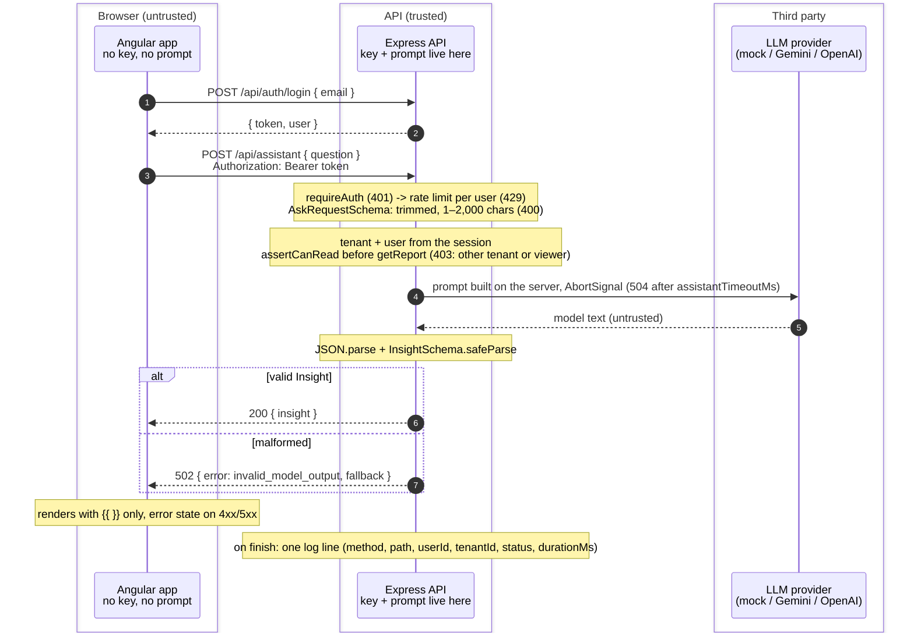

# Architecture (main)

> These docs describe the branch you are on. Each checkpoint branch updates them.

Three pieces in one npm workspace:

- **web** (`apps/web`): Angular 21 standalone, zoneless. Login + chat views.
- **api** (`apps/api`): Express 5. Fake login, company data, assistant endpoint.
- **contracts** (`packages/contracts`): Zod schemas shared by both (`Insight`, `CompanyReport`, ...).

The **fake provider** (`/fake-provider/...`, `apps/api/src/routes/fake-provider.ts`) simulates a
third-party LLM API (Gemini-shaped) so the workshop runs offline. It is not part of the app and
the web no longer calls it.

## Request flow on main (Exercises A–D solved)

A valid `Insight` is not a safe one: the schema checks shape, not intent. See
[trust-boundaries.md](trust-boundaries.md).

`POST /api/data/report` follows the same rules: `requireAuth`, tenant from the session, a body
`tenantId` that differs from it is answered with `403`, and `assertCanRead`
(`apps/api/src/auth/authorize.ts`) runs before `getReport`. Denials throw `ForbiddenError`, which
the app error handler maps to `403 { error: 'forbidden' }`. Optional database layer:
[rls.md](rls.md).

Logs: the assistant router writes one `assistant request` line per request when the response
finishes (method, path, userId, tenantId, status, durationMs), never headers, tokens, the
question, the report or model text. `apps/api/src/logger.ts` also redacts keys such as
`authorization`, `token`, `apiKey`, `secret` and `password` as a safety net.

Tests: `apps/api/test/*.spec.ts` cover every control with negative cases (401, 403, 400, 429,
502, 504, logs). `apps/api/test/setup.ts` replaces `fetch` so any network call fails; supertest
talks to the in-process app. Summary of the changes since `step-1`:
[before-after.md](before-after.md). Production checklist: [CHECKLIST.md](../CHECKLIST.md).

## Trust boundaries

| Zone         | Trust       | Why                                                                 |
| ------------ | ----------- | ------------------------------------------------------------------- |
| Browser      | untrusted   | Users can read the bundle, edit requests and change any field.      |
| API          | trusted     | Holds secrets (`config.ts` is the only env reader), owns decisions. |
| Provider     | third party | Sees every prompt; needs a key; can be slow or down.                |
| Model output | untrusted   | Can be malformed or follow an injected instruction. Validate it.    |

## Providers

`apps/api/src/providers/`: `types.ts` (`LlmProvider`), `mock.ts` (offline, deterministic,
`MOCK_SCENARIO` = `ok | malformed | injection-echo | slow`), `gemini.ts`, `openai.ts`,
`index.ts` (`createProvider(config)`). Tests always use the mock, or pass
`createApp({ config, provider })`.
