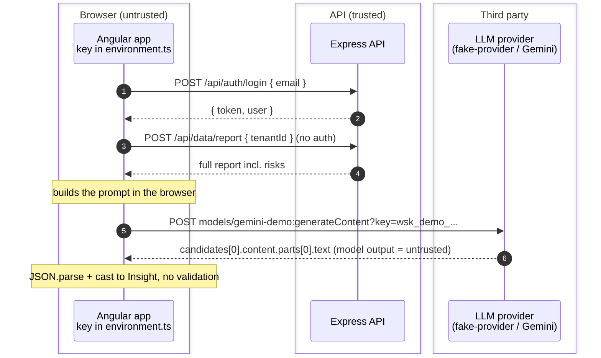

# Architecture (step 1)

Three pieces in one npm workspace:

- **web** (`apps/web`): Angular 21 standalone, zoneless. Login + chat views.
- **api** (`apps/api`): Express 5. Fake login, company data, assistant endpoint.
- **contracts** (`packages/contracts`): Zod schemas shared by both (`Insight`, `CompanyReport`, ...).

The **fake provider** (`/fake-provider/...`, `apps/api/src/routes/fake-provider.ts`) simulates a
third-party LLM API (Gemini-shaped) so the workshop runs offline. It is not part of the app.

## Request flow on step 1 (insecure on purpose)

`POST /api/assistant { question, tenantId }` also exists and returns `{ raw }`, but it has no
auth, no rate limit and no timeout. Exercise A moves the browser onto it.

## Trust boundaries

| Zone         | Trust       | Why                                                                 |
| ------------ | ----------- | ------------------------------------------------------------------- |
| Browser      | untrusted   | Users can read the bundle, edit requests and change any field.      |
| API          | trusted     | Holds secrets (`config.ts` is the only env reader), owns decisions. |
| Provider     | third party | Sees every prompt; needs a key; can be slow or down.                |
| Model output | untrusted   | Can be malformed or follow an injected instruction. Validate it.    |

## Providers

`apps/api/src/providers/`: `types.ts` (`LlmProvider`), `mock.ts` (offline, deterministic,
`MOCK_SCENARIO` = `ok | malformed | injection-echo | slow`), `gemini.ts`, `openai.ts`,
`index.ts` (`createProvider(config)`). Tests always use the mock, or pass
`createApp({ config, provider })`.
