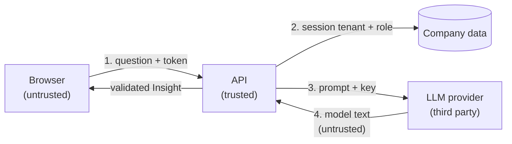

# Trust boundaries

> These docs describe the branch you are on. Each checkpoint branch updates them.

A trust boundary is any place where data moves from a zone you do not control into one you do.
Every value that crosses one is checked on the trusted side. The AI feature has four.

| #   | Boundary                   | What crosses it                         | Control                                                                                                                            | Exercise |
| --- | -------------------------- | --------------------------------------- | ---------------------------------------------------------------------------------------------------------------------------------- | -------- |
| 1   | Browser → API              | Question, bearer token, any body field  | `requireAuth` (401), rate limit per user (429), `AskRequestSchema` (trimmed, 1–2,000 chars, 400)                                   | A, B     |
| 2   | API → data                 | Tenant id and role used to load reports | Tenant and user from the session, `assertCanRead` before any read (403)                                                            | C        |
| 3   | API → provider             | Prompt with company data, provider key  | Key and prompt live on the server only (`config.ts`), timeout (504), logs without headers, tokens or prompts                       | A, D     |
| 4   | Provider output → API / UI | Model text                              | `JSON.parse` + `InsightSchema.safeParse` (502 `invalid_model_output` with a fallback), rendered with Angular interpolation `{{ }}` | B        |

## Rules that hold on every branch

- **The browser is not a control.** Client-side checks (the 2,000-character counter, a hidden
  button) are UX. The API repeats every check.
- **Schema checks shape, not intent.** With `MOCK_SCENARIO=injection-echo` the answer is a valid
  `Insight` and still carries a leaked system prompt, HTML and SQL. Validated output is still
  untrusted data.
- **Never execute model output.** No `innerHTML`, no `eval`, no shell, no SQL built from it, no
  tool call without a server-side permission check. Display it as text.
- **Identity comes from the session.** A `tenantId` or role in a request body is a claim, not a
  fact.
- **Log the reason, not the content.** Error names and issue paths are fine; tokens, headers,
  prompts and raw model text are not.
